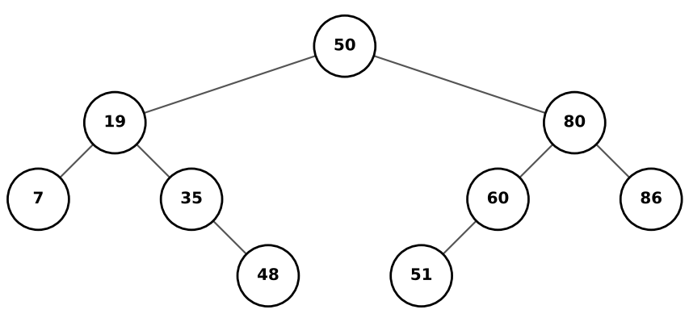
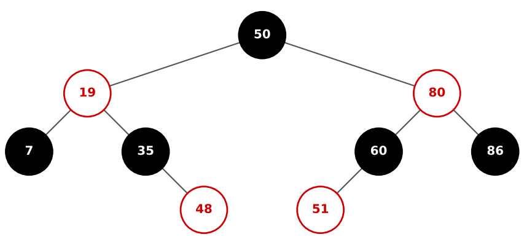
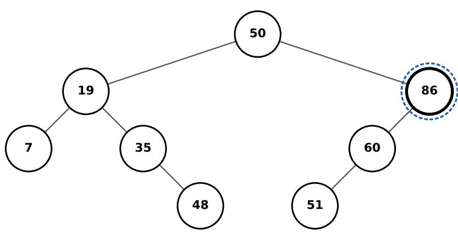
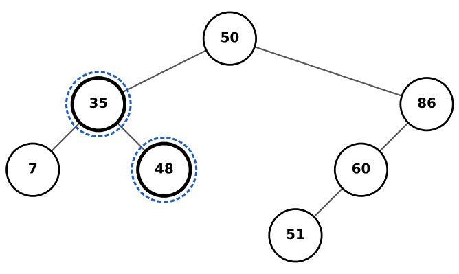
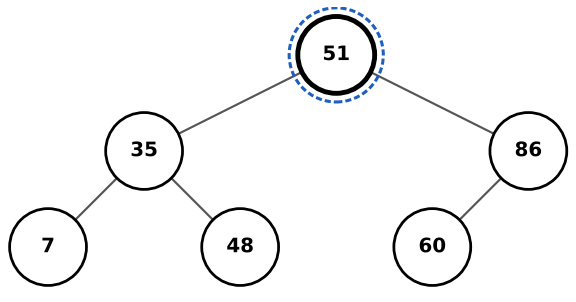
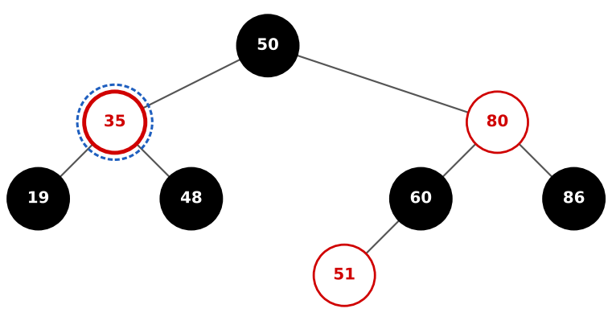
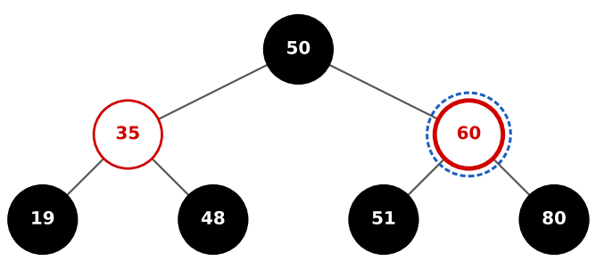
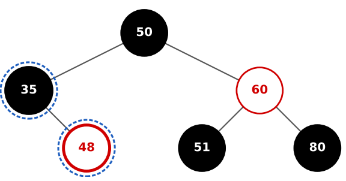

# Лабораторна робота № 7 — Робота з бінарним та червоно-чорним деревами пошуку

## Варіант 22

Вхідна послідовність ключів: `50, 80, 19, 86, 35, 7, 60, 48, 51` (`n = 9`).

Висоту дерева рахуємо за кількістю рівнів вузлів (корінь — перший рівень), як у методичних вказівках.

## Результати

### Побудова дерев

| Бінарне дерево пошуку (BST) | Червоно-чорне дерево (RB tree) |
|:---:|:---:|
|  |  |
| висота 4 | висота 4, чорна висота 2 |

Під час побудови червоно-чорного дерева тричі виник випадок 1 — вставка `86`, `48` і `51` (дядько червоний, достатньо перефарбування). Випадки 2 і 3 з поворотами не знадобились, тому RB tree має ту саму форму, що й BST, і відрізняється лише кольорами вузлів.

На рисунках у RB tree чорні вузли зафарбовано чорним, а червоні мають червоний контур. Синім пунктиром виділено вузол, доданий або переміщений на поточному кроці.

### Обходи (однакові для BST і RB tree)

| Обхід | Результат |
|---|---|
| симетричний (`inorderTraversal`) | `7, 19, 35, 48, 50, 51, 60, 80, 86` |
| прямий (`preorderTraversal`) | `50, 19, 7, 35, 48, 80, 60, 51, 86` |
| зворотний (`postorderTraversal`) | `7, 48, 35, 19, 51, 60, 86, 80, 50` |

Стек викликів `inorderTraversal`: у таблицях 7.2–7.3 звіту наведено 17 станів стека без відображення викликів для порожніх вузлів. Максимальна кількість одночасно активних викликів для непорожніх вузлів дорівнює 4. Якщо врахувати виклики для `null`, то всього викликів 19 (9 + 10), а максимальна глибина стека дорівнює 5.

### Видалення з BST (корінь правого піддерева → корінь лівого піддерева → основний корінь)

| Видалено `80` | Видалено `19` | Видалено `50` |
|:---:|:---:|:---:|
|  |  |  |
| на місце `80` стає `86` (мінімум правого піддерева) | на місце `19` стає `35`, на місце `35` — `48` | новим коренем стає `51`, висота 3 |

### Видалення з RB tree (чорні вузли, обидва сини яких — чорні NIL)

| Видалено `7` | Видалено `86` | Видалено `19` |
|:---:|:---:|:---:|
|  |  |  |
| випадок 2: лівий поворот навколо `19–35` | випадок 2 (дзеркальний): правий поворот навколо `80–60` | випадок 1: `48` → червоний, `35` → чорний |

Після всіх видалень чорна висота дорівнює 2, а висота — 3.

## Структура репозиторію

| Файл | Опис | Відповідає у звіті |
|---|---|---|
| `images/bst.png`, `images/rb_tree.png` | Побудовані BST і RB tree | Рисунок 7.1 |
| `images/bst_insert_step1.png` … `step9.png` | Покрокова побудова BST | Таблиця 7.1 |
| `images/rb_insert_step1.png` … `step9.png` | Покрокова побудова RB tree (після балансування) | Таблиця 7.1 |
| `images/bst_delete_1.png` … `bst_delete_3.png` | BST після кожного видалення | Таблиця 7.4 |
| `images/rb_delete_N_before.png`, `rb_delete_N_after.png` | RB tree з «двічі чорним» NIL та після балансування | Таблиця 7.5 |
| `ЛР7_22_АІ254_Церковний_Олександр.docx` | Звіт з лабораторної роботи | — |
| `ЛР7_22_АІ254_Церковний_Олександр.pdf` | Звіт у форматі PDF | — |
